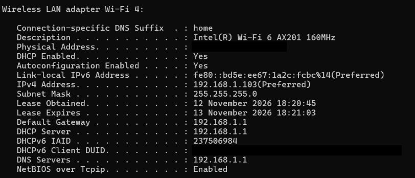
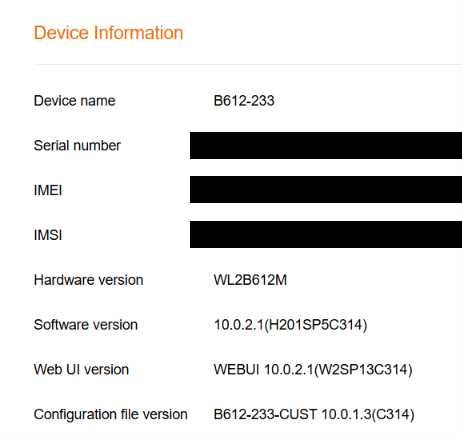
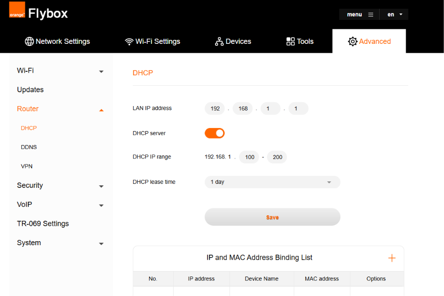
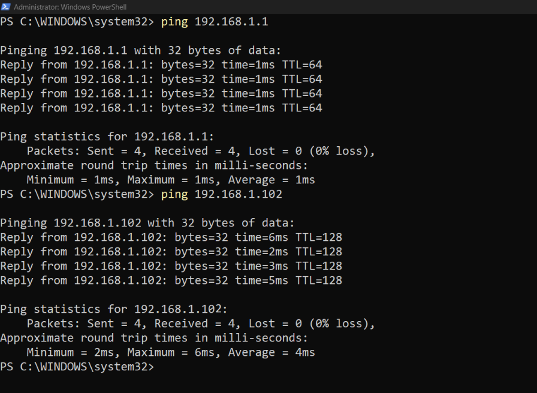
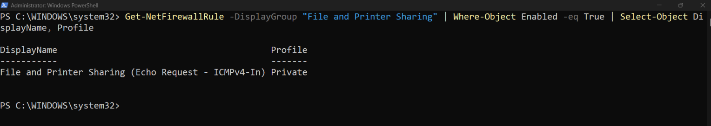
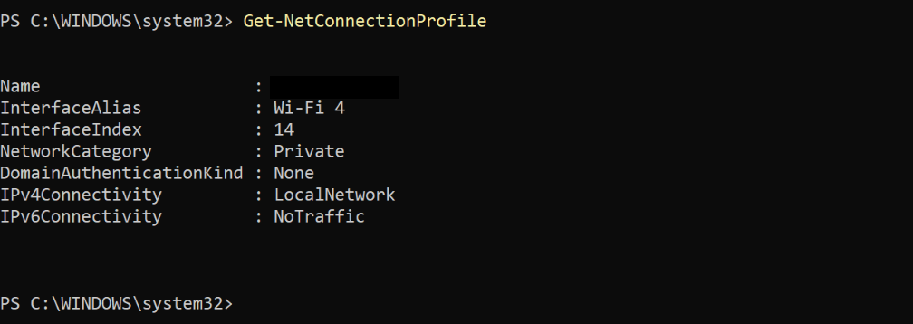

# Lab 0.1 — Physical Network Assessment

**Organization:** Butty Technologies (simulated)
**Category:** Network administration · Infrastructure documentation
**Status:** Complete
**Related change:** [CHG-001](../CHANGELOG.md)

---

## 1. Exercise title

Physical network assessment and baseline documentation.

## 2. Business scenario

Butty Technologies is preparing to deploy a Windows Server domain controller. Before any new infrastructure is connected, the IT team must document the existing network: addressing, DHCP configuration, connectivity and host firewall posture. **No changes to production network equipment are permitted during the assessment.**

## 3. Learning objectives

- Read and interpret `ipconfig /all` output.
- Identify the gateway, DHCP server, DNS server and address range of a LAN.
- Test connectivity methodically, from the nearest device outward.
- Interpret ICMP results, including latency, jitter and TTL values.
- Investigate unexpected results with evidence rather than assumptions.
- Plan safe static IP ranges that avoid DHCP conflicts.
- Apply a controlled, reversible configuration change.

## 4. Lab environment

| Device | Hostname | OS | Connection | IPv4 address |
|---|---|---|---|---|
| Router | — | Huawei B612 4G LTE router (ISP-provided) | — | 192.168.1.1 |
| Primary PC | ButtyTheGreat | Windows 11 Pro | Wi-Fi | 192.168.1.103 (DHCP) |
| Secondary PC | SUCCESS | Windows 11 Pro | Wi-Fi | 192.168.1.102 (DHCP) |

Internet access is provided by a SIM card in the router. Router identifiers (serial number, IMEI, IMSI), Wi-Fi credentials and the network name are intentionally excluded from this document.

## 5. Network topology

```
        Internet (4G LTE)
               │
     ┌─────────┴─────────┐
     │   Huawei router   │  192.168.1.1
     │ Gateway·DHCP·DNS  │
     └────┬─────────┬────┘
      Wi-Fi       Wi-Fi
          │         │
 ┌────────┴───┐  ┌──┴──────────┐
 │ButtyTheGreat│  │   SUCCESS   │
 │ .103        │  │ .102        │
 └─────────────┘  └─────────────┘
       Network: 192.168.1.0/24
```

## 6. Findings

### 6.1 Addressing and services

| Setting | Value | Source |
|---|---|---|
| Network | 192.168.1.0/24 | `ipconfig /all` |
| Subnet mask | 255.255.255.0 | `ipconfig /all` |
| Default gateway | 192.168.1.1 | `ipconfig /all` |
| DHCP server | 192.168.1.1 | `ipconfig /all` |
| DNS server | 192.168.1.1 | `ipconfig /all` |
| DNS suffix | `home` | `ipconfig /all` |
| DHCP pool | 192.168.1.100 – 192.168.1.200 | Router admin page |
| DHCP lease time | 1 day | Router admin page; matches the 24-hour lease in `ipconfig /all` |
| DHCP reservations | None configured | Router admin page |

The router acts as the gateway, DHCP server and DNS forwarder for the LAN.

### 6.2 Address allocation plan

| Range | Purpose |
|---|---|
| 192.168.1.1 | Router |
| 192.168.1.2 – 192.168.1.99 | Available for static assignment |
| 192.168.1.100 – 192.168.1.200 | Router DHCP pool. **Do not use for static IPs.** |
| 192.168.1.201 – 192.168.1.254 | Available for static assignment |

Any lab system that needs a static IP on this LAN must use an address outside the DHCP pool to prevent IP conflicts. No additional DHCP server may be run on this network.

### 6.3 Windows network profiles (before change)

| Host | Interface | NetworkCategory |
|---|---|---|
| ButtyTheGreat | Wi-Fi 4 | Public |
| SUCCESS | Wi-Fi | Public |

## 7. Commands used

```powershell
hostname
ipconfig /all
ping 192.168.1.1
ping 192.168.1.102
ping 192.168.1.103
Get-NetConnectionProfile | Select-Object Name, InterfaceAlias, NetworkCategory, IPv4Connectivity
Get-NetFirewallRule -DisplayName "*Echo Request*" | Where-Object Direction -eq Inbound | Select-Object DisplayName, Enabled, Profile, Action
Get-NetFirewallRule -DisplayGroup "File and Printer Sharing" | Where-Object Enabled -eq True | Select-Object DisplayName, Profile
```

## 8. Testing and verification

| Test | Source → destination | Result | Notes |
|---|---|---|---|
| Gateway reachability | ButtyTheGreat → router | 4/4 replies, ~1 ms | TTL=64 |
| Gateway reachability | SUCCESS → router | 4/4 replies | Confirmed by technician |
| Host to host | ButtyTheGreat → SUCCESS | 4/4 replies, 41–166 ms across tests | TTL=128 |
| Host to host | SUCCESS → ButtyTheGreat | 4/4 replies | Confirmed by technician |

### Observations

- **TTL values:** The router replied with TTL=64, typical of Linux-based network devices. The Windows PCs replied with TTL=128, the Windows default. TTL can hint at a device's operating system, but it isn't proof.
- **Latency and jitter:** Router replies took about 1 ms, but PC-to-PC replies took 41–166 ms and varied between tests. Traffic between the PCs crosses the wireless link twice, and Wi-Fi adds variable delay from shared airtime and adapter power saving. Wired Ethernet is recommended before domain services are deployed.

## 9. Problems encountered

**Unexpected result:** Both PCs were on the *Public* network profile, where Windows normally blocks inbound ICMP echo requests. Even so, pings succeeded in both directions.

## 10. Troubleshooting steps

1. Formed a hypothesis: an enabled firewall rule was allowing inbound ICMP on the Public profile.
2. Queried the firewall rules. Only one rule from the File and Printer Sharing group was enabled: **File and Printer Sharing (Echo Request - ICMPv4-In)**, with profiles **Private, Public**.
3. Root cause: this rule had been enabled earlier for testing, and the change wasn't recorded.
4. Remediation: applied [CHG-001](../CHANGELOG.md) to set the trusted home network to *Private* on both PCs and restrict the rule to the *Private* profile only.

### Post-change verification (ButtyTheGreat)

| Check | Result |
|---|---|
| NetworkCategory | Private |
| Enabled sharing rules | Echo Request - ICMPv4-In → Private only |
| Ping to SUCCESS | 4/4 replies |

The same change was applied to SUCCESS and confirmed by the technician.

> **Update (18 Nov 2026):** Network categories are stored **per network**. After the router was replaced, Windows treated the new network as Public, so this change no longer applied there. It was re-applied as [CHG-011](../CHANGELOG.md); see [Lab 0.3](network-migration.md).

## 11. Evidence

> **Note on recaptured evidence:** Figures 4–6 were recaptured on 17 Nov 2026 with the original router temporarily reconnected, because the original outputs were recorded as text only. The ping latencies in Figure 4 (2–6 ms) differ from the original test (41–166 ms) because conditions differed on the day; the configuration shown is unchanged.

Screenshots are stored in [`screenshots/lab-0.1/`](screenshots/lab-0.1/). MAC addresses, DUIDs, router identifiers and network names are redacted.

**Figure 1: ButtyTheGreat Wi-Fi adapter on 192.168.1.0/24 (captured 12 Nov 2026)**



**Figure 2: Router model and firmware; serial number, IMEI and IMSI redacted**



**Figure 3: Router DHCP settings: pool .100–.200, 1-day lease**



**Figure 4: Pings to the router (TTL=64) and to SUCCESS (TTL=128)**



**Figure 5: CHG-001 result: the echo-request rule enabled for the Private profile only**



**Figure 6: CHG-001 result: network category Private**



## 12. Lessons learned

- **Inspect before you configure.** The assessment found that the router has its own internet connection through a SIM card, which earlier project notes didn't record.
- **Cross-check evidence.** The DHCP lease time on the router matched the lease timestamps on the client.
- **Undocumented changes cause confusion.** A forgotten firewall change led to behaviour that couldn't be explained until it was found. All changes are now recorded in a change log.
- **A test must exercise the change.** Pinging the gateway *from* a host doesn't test that host's *inbound* firewall rule. Only a ping *from another host* does.
- **Apply least exposure.** Trusted networks use the Private profile, and services are allowed only on the profiles that need them.
