# Lab 1.2 — Active Directory Forest Deployment

**Organization:** Butty Technologies (simulated)
**Category:** Windows Server administration · Active Directory · DNS
**Status:** Complete
**Related changes:** [CHG-006, CHG-007](../CHANGELOG.md) · **Prerequisite:** [Lab 1.1](../02-windows-server/dc01-preparation.md)

> **Note:** This lab was carried out while DC01 was at 192.168.1.10. The server was later moved to 192.168.5.10 in [Lab 0.3](../01-home-lab-infrastructure/network-migration.md), and all checks were repeated there.

---

## 1. Business scenario

Butty Technologies needs centralised identity: one account per employee that works on every company computer, managed from one place. DC01 is promoted to the first domain controller of a new forest.

## 2. Learning objectives

- Understand forests, domains, domain controllers and why AD depends on DNS.
- Install a server role and promote a domain controller with PowerShell.
- Rehearse a major change with a test command before applying it.
- Verify AD component by component: directory, services, shares and DNS.
- Tell real problems from noise in `dcdiag` and the event logs.

## 3. Design

| Setting | Value | Reason |
|---|---|---|
| Deployment | New forest | First domain for the organisation |
| Domain (DNS name) | `ad.buttytechnologies.test` | A subdomain of a company namespace; `.test` is reserved and can never clash with a real domain |
| NetBIOS name | `BUTTYTECH` | Avoids the poor default `AD` (users sign in as `BUTTYTECH\user`) |
| DNS | Installed on DC01 | Clients locate DCs through DNS SRV records |
| DSRM password | Unique, stored in a password manager | Emergency recovery credential; never published |

## 4. Implementation

### 4.1 Recovery point

Snapshot `02 - DC01 prepared - before AD DS`, taken after pre-flight checks confirmed the hostname, static IP and time zone.

### 4.2 Install the role

```powershell
Install-WindowsFeature AD-Domain-Services -IncludeManagementTools
Get-WindowsFeature AD-Domain-Services   # Install State: Installed
```

Installing the role only adds the software; the server is not yet a domain controller.

### 4.3 Test, then promote (CHG-006)

```powershell
Test-ADDSForestInstallation -DomainName "ad.buttytechnologies.test" -DomainNetbiosName "BUTTYTECH" -InstallDns
Install-ADDSForest          -DomainName "ad.buttytechnologies.test" -DomainNetbiosName "BUTTYTECH" -InstallDns
```

The test returned **Success**, with one expected warning: a DNS delegation can't be created, because no parent zone exists for this new namespace. The promotion completed, and the server restarted automatically.

## 5. Verification

| Check | Command | Result |
|---|---|---|
| Domain sign-in | Settings → Accounts | `Administrator@ad.buttytechnologies.test` ✓ |
| Forest | `Get-ADForest` | `ad.buttytechnologies.test`, **Windows2025Forest** ✓ |
| Domain | `Get-ADDomain` | NetBIOS **BUTTYTECH**, **Windows2025Domain** ✓ |
| Domain controller | `Get-ADDomainController` | DC01, Global Catalog **True**, `Default-First-Site-Name` ✓ |
| Services | `Get-Service NTDS, KDC, Netlogon, DNS, ADWS` | All Running ✓ |
| Shares | `Get-SmbShare` | SYSVOL and NETLOGON present ✓ |
| Domain record | `Resolve-DnsName ad.buttytechnologies.test` | A → DC01 ✓ |
| DC locator record | `Resolve-DnsName -Type SRV _ldap._tcp.dc._msdcs.ad.buttytechnologies.test` | → `dc01.ad.buttytechnologies.test` ✓ |
| Internet names | `Resolve-DnsName google.com` | Resolved through the forwarder ✓ |
| Forwarder | `Get-DnsServerForwarder` | The router's address; root hints as fallback ✓ |
| Primary DNS suffix | `ipconfig /all` | `ad.buttytechnologies.test` ✓ |
| Network profile | `Get-NetConnectionProfile` | **DomainAuthenticated** ✓ |

**Functional level:** Windows Server 2025 for both forest and domain. This enables the newest AD features but requires every future DC to run Windows Server 2025 or later.

## 6. Problems encountered and analysis

| Finding | Evidence | Conclusion |
|---|---|---|
| `dcdiag` SystemLog failed | Event 1796: *"Secure Boot is not enabled on this machine"* | Unrelated to AD; the VM runs without Secure Boot. Logged as a hardening item. |
| `dcdiag` DFSREvent failed | DFS Replication log showed event **4602**, *"successfully initialized the SYSVOL replicated folder"* | Warnings came from first-boot initialisation; SYSVOL is healthy |
| Network profile showed `IPv4Connectivity: NoTraffic` | `Test-NetConnection www.msftconnecttest.com -Port 80` → **TcpTestSucceeded: True** | The connectivity indicator was stale; the internet worked. Test the service, not the label. |
| DNS client set to loopback only (`::1`, `127.0.0.1`) by promotion | `ipconfig /all` | Best practice is the real IP first, loopback last. Partially applied (CHG-007), then completed in CHG-010. |

## 7. Lessons learned

- **Rehearse major changes:** `Test-ADDSForestInstallation` validates prerequisites without changing anything.
- **Know which warnings are expected,** and read their final sentence ("Otherwise, no action is required").
- **The SRV record is the heart of AD discovery.** Every domain join and login depends on that one query.
- **`dcdiag` output needs interpretation.** A "failed test" can be noise; the underlying event decides.
- **Build commands from meaning:** `Resolve-DnsName` (the action) + `-Type SRV` (the record type) + `_ldap._tcp.dc._msdcs.<domain>` (service, protocol, role, zone, domain).

## 8. Evidence

Screenshots are stored in [`screenshots/lab-1.2/`](screenshots/lab-1.2/). MAC addresses, DUIDs, router identifiers and network names are redacted.

**Figure 1: Pre-flight: hostname and static IP confirmed**

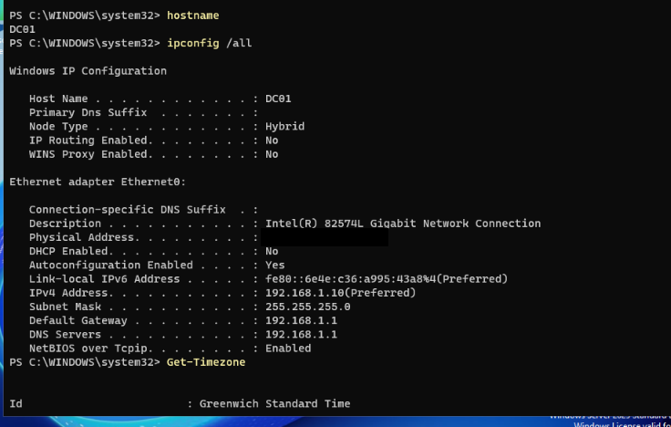

**Figure 2: Pre-flight: time zone confirmed**

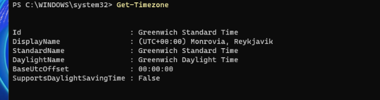

**Figure 3: AD DS role installed**

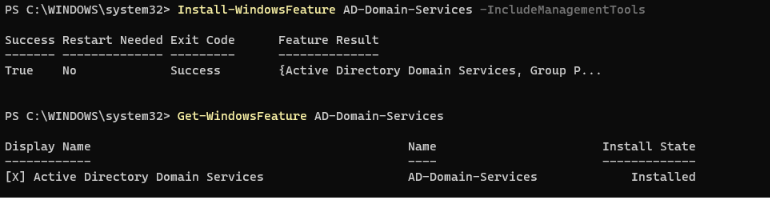

**Figure 4: Recovery point before promotion**

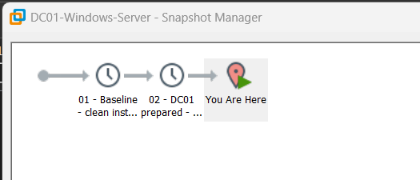

**Figure 5: Test-ADDSForestInstallation: Success, with the expected DNS delegation warning**

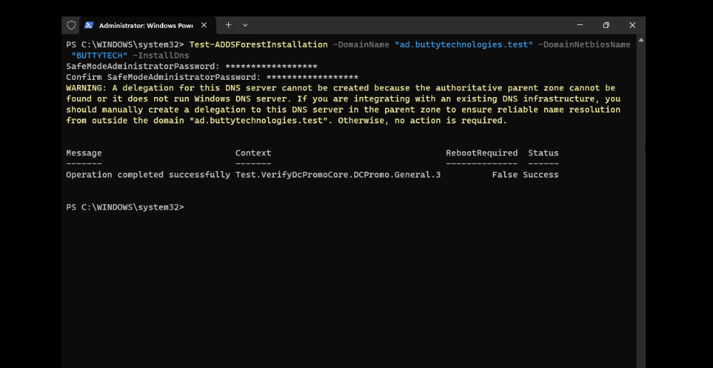

**Figure 6: Signed in as Administrator@ad.buttytechnologies.test**

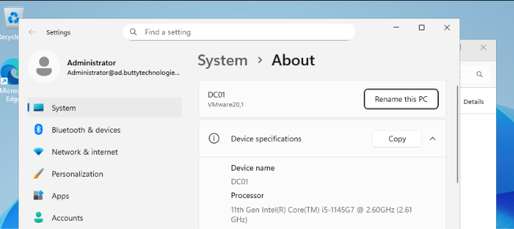

**Figure 7: Forest, domain, domain controller and AD services**

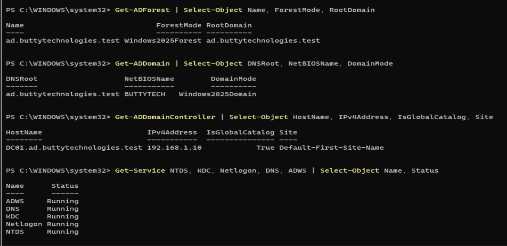

**Figure 8: SYSVOL and NETLOGON shares, domain A record and DC locator SRV record**

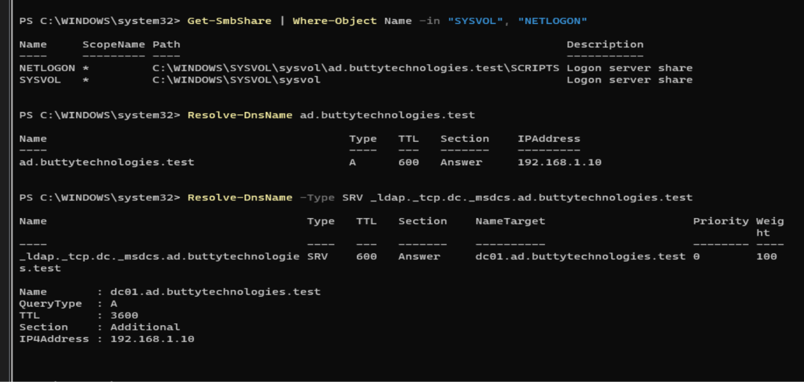

**Figure 9: Network profile DomainAuthenticated**

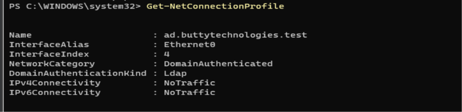

**Figure 10: After promotion: primary DNS suffix set; DNS client on loopback**

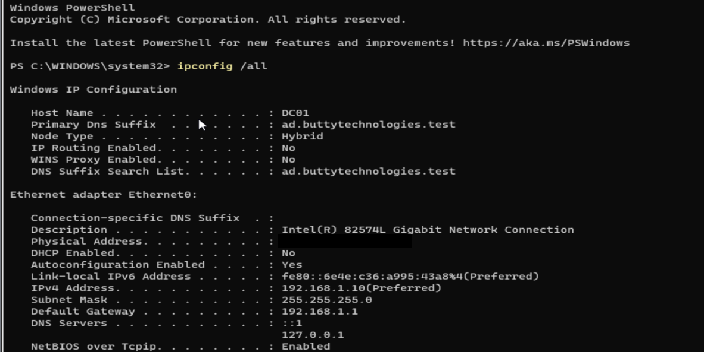

**Figure 11: First dcdiag: DFSREvent and SystemLog (Secure Boot) findings**

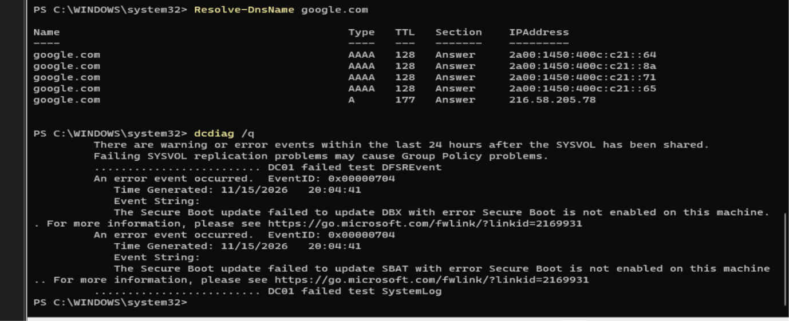

**Figure 12: Event 4602: SYSVOL initialised successfully**

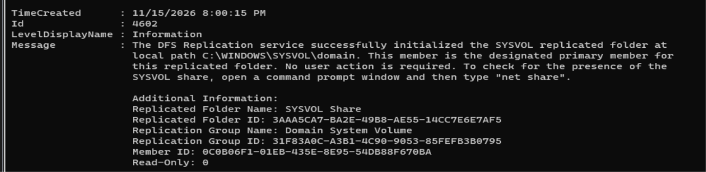

**Figure 13: Forwarder configured and internet connectivity confirmed**

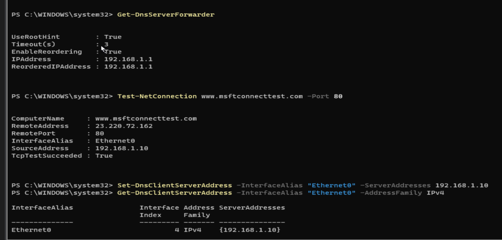

**Figure 14: Logon screen showing BUTTYTECH\Administrator**

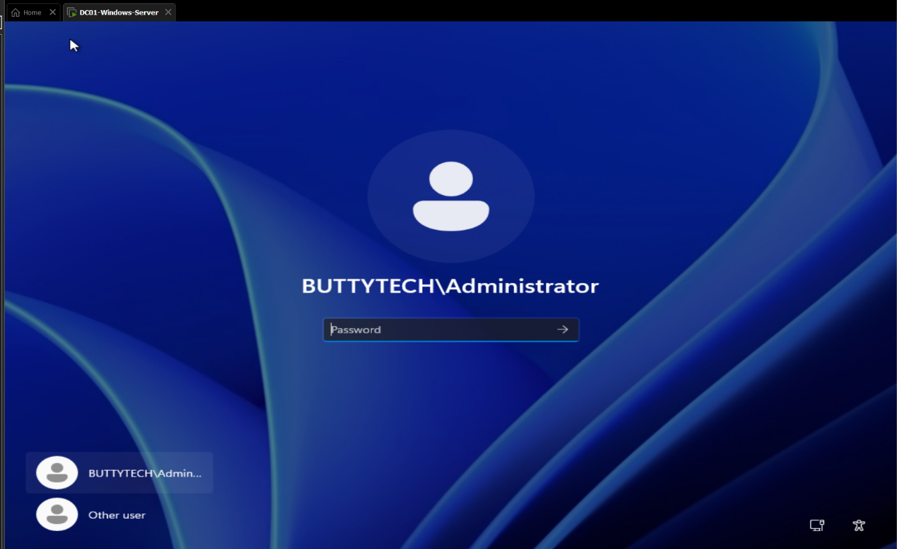
