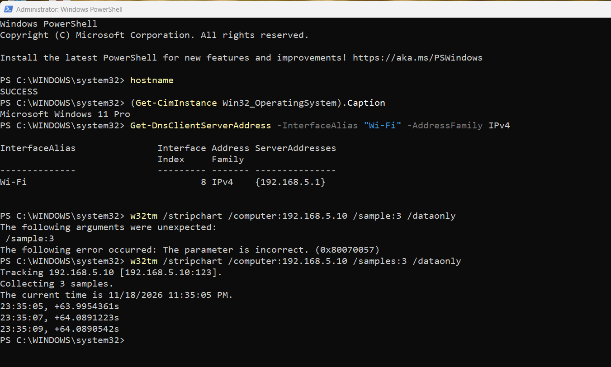
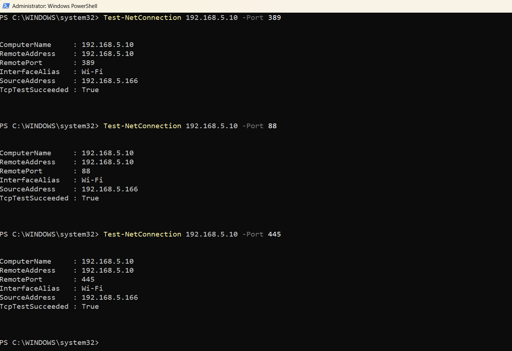
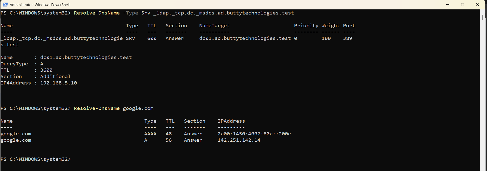
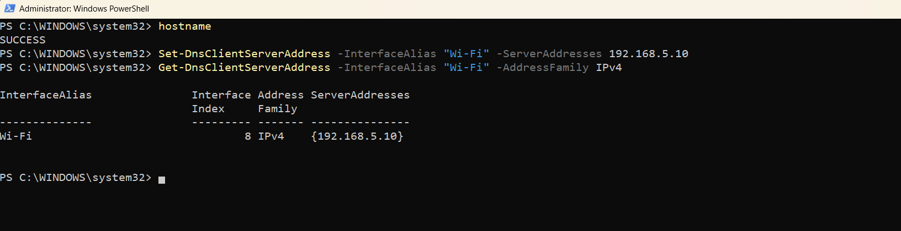
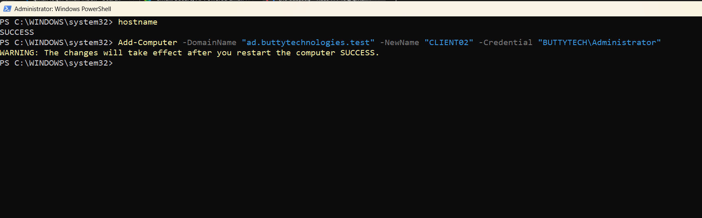
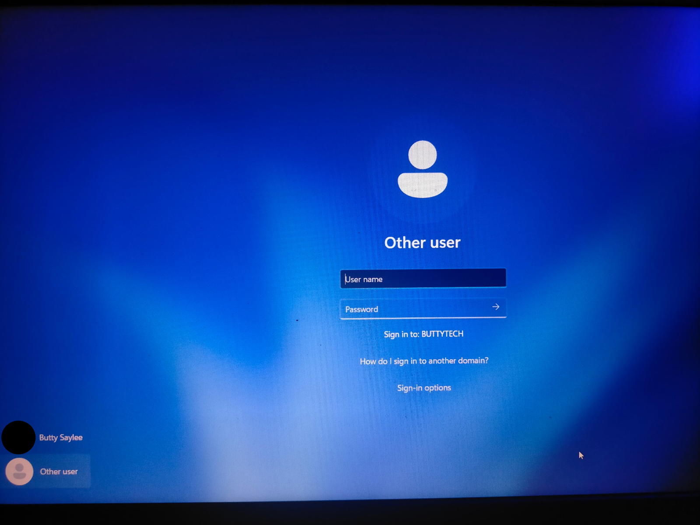
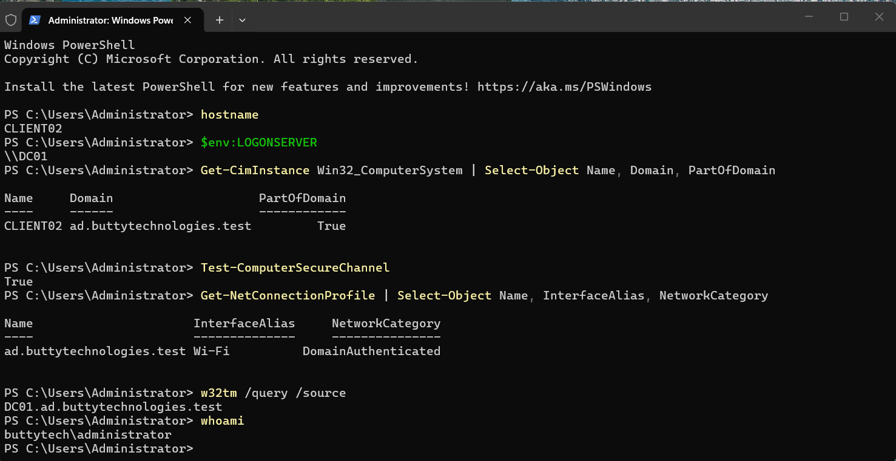
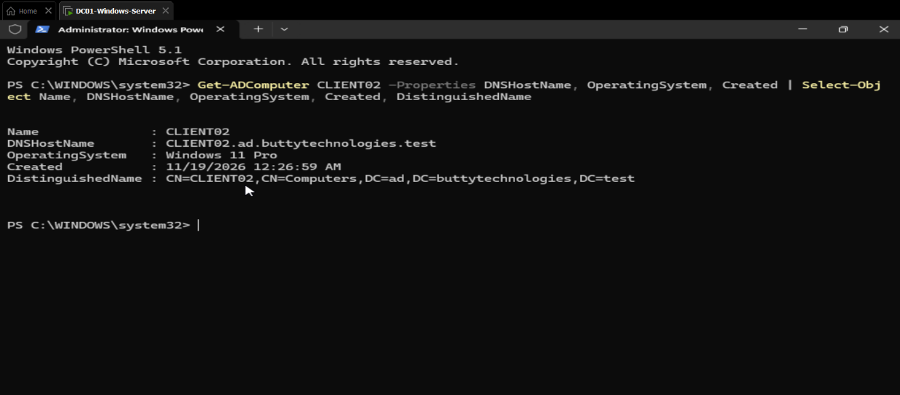
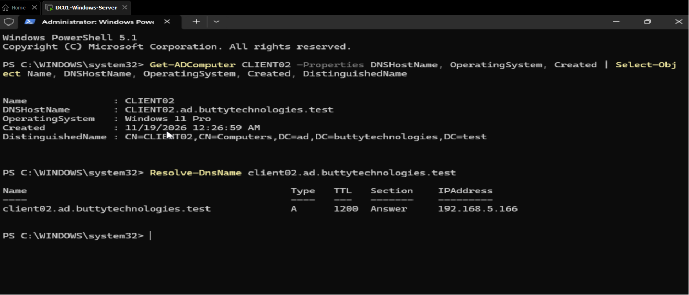

# Lab 1.3 — Join a Physical Workstation to the Domain (CLIENT02)

**Organization:** Butty Technologies (simulated)
**Category:** Active Directory · Client administration · DNS
**Status:** Complete
**Related changes:** [CHG-012, CHG-013](../CHANGELOG.md) · **Design:** [Design Decision 001, rule 3](../01-home-lab-infrastructure/network-design.md)

---

## 1. Business scenario

A new employee workstation must join the Butty Technologies domain so staff can sign in with their domain accounts, and so the computer can be managed centrally.

## 2. Learning objectives

- Identify the prerequisites for a domain join and verify each one before attempting it.
- Configure a client's DNS so it can locate a domain controller.
- Test the specific network ports a domain join depends on.
- Rename and join a computer with one PowerShell command.
- Verify membership from both the client and the domain controller.
- Understand the computer secure channel, the time hierarchy and the default Computers container.

## 3. Environment

| Item | Value |
|---|---|
| Workstation | SUCCESS → **CLIENT02** · Windows 11 Pro · Wi-Fi · 192.168.5.166 (DHCP) |
| Domain controller | DC01 · 192.168.5.10 · `ad.buttytechnologies.test` (NetBIOS `BUTTYTECH`) |
| Fallback access | The existing local account on the workstation remains usable (`.\username`) |

## 4. Join prerequisites

| Requirement | Why | Check | Result |
|---|---|---|---|
| Pro edition or higher | Home editions can't join a domain | `(Get-CimInstance Win32_OperatingSystem).Caption` | Windows 11 Pro ✓ |
| DNS points to the DC | Clients find DCs through SRV records | `Resolve-DnsName -Type SRV _ldap._tcp.dc._msdcs.ad.buttytechnologies.test` | → dc01, port 389 ✓ |
| Ports reachable | LDAP 389, Kerberos 88, SMB 445 | `Test-NetConnection 192.168.5.10 -Port <n>` | All True ✓ |
| Clocks within 5 minutes | Kerberos rejects larger skew | `w32tm /stripchart /computer:192.168.5.10 /samples:3 /dataonly` | ~64 s ✓ (see 7.1) |

## 5. Implementation

### 5.1 CHG-012 — Point the client's DNS to DC01

```powershell
Set-DnsClientServerAddress -InterfaceAlias "Wi-Fi" -ServerAddresses 192.168.5.10
```

DC01 is the **only** DNS server; the router is deliberately not added as a backup. Internet names still resolve, because DC01 forwards them to the router.

### 5.2 CHG-013 — Rename and join

```powershell
Add-Computer -DomainName "ad.buttytechnologies.test" -NewName "CLIENT02" -Credential "BUTTYTECH\Administrator"
Restart-Computer
```

The command returned only the expected warning (*"The changes will take effect after you restart the computer"*). After the restart, the sign-in screen offered **"Sign in to: BUTTYTECH"**.

> The domain Administrator account was used because it was the only domain account available. In production, joins are done with a delegated, limited account (least privilege). Delegation is planned for a later lab.

## 6. Verification

| Check | Where | Result |
|---|---|---|
| `hostname` | CLIENT02 | CLIENT02 ✓ |
| `whoami` | CLIENT02 | `buttytech\administrator` ✓ |
| `$env:LOGONSERVER` | CLIENT02 | `\\DC01` ✓ |
| `Win32_ComputerSystem` | CLIENT02 | Domain `ad.buttytechnologies.test`, PartOfDomain **True** ✓ |
| `Test-ComputerSecureChannel` | CLIENT02 | **True** ✓ |
| `Get-NetConnectionProfile` | CLIENT02 | **DomainAuthenticated** ✓ |
| `w32tm /query /source` | CLIENT02 | `DC01.ad.buttytechnologies.test` ✓ |
| `Get-ADComputer CLIENT02` | DC01 | Windows 11 Pro, created 19 Nov 2026 00:26:59, in `CN=Computers` ✓ |
| `Resolve-DnsName client02.ad.buttytechnologies.test` | DC01 | A record → 192.168.5.166 (TTL 1200) ✓ |

## 7. Findings

### 7.1 Clock offset (~64 seconds)

The offset is within Kerberos's 5-minute tolerance, so it didn't block the join. But domain members take their time from the DC, and DC01, as the forest's first DC, isn't syncing with any reliable external source. Its drift would spread to every member. **Follow-up:** Lab 1.4 configures DC01's time source.

### 7.2 The default Computers container

New computer accounts land in `CN=Computers`, which is a *container*, not an organisational unit, so Group Policy can't be linked to it. **Follow-up:** Lab 1.5 creates OUs and moves CLIENT02.

### 7.3 Ping side effect

After the join, CLIENT02's profile became **DomainAuthenticated**. The echo-request rule from CHG-001/CHG-011 covers only the Private profile, so CLIENT02 no longer answers pings. **Follow-up:** manage this rule centrally with Group Policy (Lab 1.6).

### 7.4 The secure channel

Joining creates a computer account whose password is shared by the computer and the domain. If they fall out of sync (for example, after restoring an old image of the workstation), users get *"The trust relationship between this workstation and the primary domain failed"*. `Test-ComputerSecureChannel` checks it; `Test-ComputerSecureChannel -Repair` can fix it.

## 8. Rollback

```powershell
Remove-Computer -UnjoinDomainCredential "BUTTYTECH\Administrator" -WorkgroupName "WORKGROUP" -Restart   # on CLIENT02
Remove-ADComputer CLIENT02                                                                              # on DC01, afterwards
Set-DnsClientServerAddress -InterfaceAlias "Wi-Fi" -ResetServerAddresses                                # on the client
```

## 9. Lessons learned

- **Verify prerequisites first.** When every requirement has been checked beforehand, a failed join points straight at what's left.
- **DNS is the foundation of a domain join.** The SRV lookup from the client is the single most useful pre-check.
- **Keep a way back in.** Local accounts survive a domain join, and on physical machines without snapshots they're the recovery path.
- **Firewall rules follow network profiles.** Joining a domain changes the profile and therefore which rules apply.
- **Defaults are a starting point.** The Computers container and the DC's unsynchronised clock both work, but neither is how a well-run domain is configured.

## 10. Evidence

Screenshots are stored in [`screenshots/lab-1.3/`](screenshots/lab-1.3/).

**Figure 1: Pre-checks: edition, DNS, time offset**



**Figure 2: CHG-012: DNS pointed to DC01 only**



**Figure 3: SRV record (port 389) and internet resolution from the client**



**Figure 4: LDAP, Kerberos and SMB ports reachable**



**Figure 5: CHG-013: rename and join command**



**Figure 6: Sign-in screen offering BUTTYTECH (profile picture redacted)**



**Figure 7: Membership, secure channel, profile and time source verified on CLIENT02**



**Figure 8: Computer object in Active Directory**



**Figure 9: CLIENT02 registered its own DNS record**


